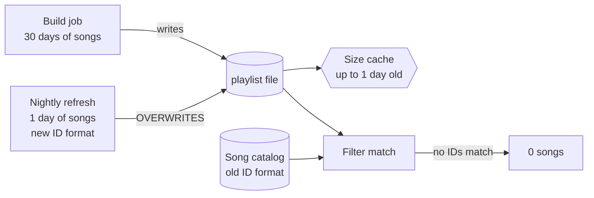

# Demo Scenario: The Shrinking Smart Playlist

A fictional, self-contained scenario for demonstrating the learning skills. It teaches three common real-world bug patterns (overwritten state, mismatched identifiers, and stale caches) without depending on any real product.

## The setup (read this to the audience)

**Tunewell** is a made-up music app. Users can create a **smart playlist** from a description like "upbeat songs I've played in the last 30 days." Behind the scenes:

1. **Build:** When the playlist is created, a job collects every matching song from the last 30 days of listening history and saves the list to a file.
2. **Nightly refresh:** Every night, another job adds songs the user played that day.
3. **Filters:** Users can narrow a playlist with filters like "genre: jazz" or "released after 2020." Filters work by matching the playlist's song list against a separate song catalog.
4. **Cache:** Playlist sizes are cached for up to a day so the app loads quickly.

## The bug report

> "My smart playlist had 400 songs when I made it on Monday. By Thursday it's down to 30. And when I add the 'jazz' filter, it shows **zero** songs, even though I definitely listen to jazz."

## What actually happened (facilitator notes)

There are three separate problems, which is what makes it a good teaching case.

1. **Shrinking: overwritten state.** The nightly refresh writes to the *same file name* as the original build. Instead of adding one day of songs to 30 days of history, it replaces the 30-day list with a 1-day list. The playlist "shrinks" to whatever the user played yesterday.
2. **Zero with a filter: mismatched identifiers.** The refresh job was written later and saves songs using a newer ID format. The catalog the filters match against still uses the old format. Nothing matches, so any filter returns zero. That's a different bug from the shrinking, which is why the drop to zero seemed so dramatic.
3. **Confusing timing: stale cache.** The cached size lags up to a day behind, so the numbers users see don't line up with when the jobs ran, which made the investigation harder.

**Patterns to name:** overwritten state (two writers, one location), identifier mismatch (two systems that disagree about what an ID looks like), and stale cache (the display trusts a copy that doesn't know the original changed).

## Running the demo

**Act 1: the oracle (2 min).** Paste the bug report into a session *without* the skills and ask for the root cause. Show the correct, dense answer. Ask the room: "Could you diagnose the next one of these on your own?" Most people can't.

**Act 2: learning-loop (6–8 min).** Same report, with the skills on, and say "teach me while we figure this out." Things to point out as they happen:
- **Predict-first:** "Before we look, why might adding a filter make it go to zero instead of just smaller?" Take guesses from the room.
- **Show it:** the diagram above, normal flow vs. what happened.
- **Name the pattern:** overwritten state, identifier mismatch, stale cache.
- **Climb Bloom's:**
  - *Remember:* "Which job writes the playlist file?"
  - *Understand:* "In one sentence, why did it shrink instead of grow?"
  - *Apply:* "What would you check to confirm the overwrite theory?" (Answer: compare the file's size or song dates before and after the nightly run.)
  - *Analyze (variant):* "Suppose the refresh job is fixed, but filters still return zero. What's still broken?"
  - *Evaluate:* "Someone proposes clearing the cache every hour. Does that fix anything?" (Answer: no. It makes the wrong numbers show up faster.)

**Act 3: check-understanding + knowledge-handoff (3 min).** Run a 3-question quiz with the room. Then use interview mode to produce a half-page incident debrief from the audience's answers.

**The punchline:** in about ten minutes the room went from "what's a refresh job?" to explaining three bugs, and left a document the next person can learn from.

## Variant prompts for practice
- "The playlist grows forever and never drops old songs." (Missing expiry or retention logic.)
- "Filters work for new playlists but not old ones." (Identifier mismatch in the other direction.)
- "Size is right in the app but wrong in the weekly email." (Two readers, different caches.)
